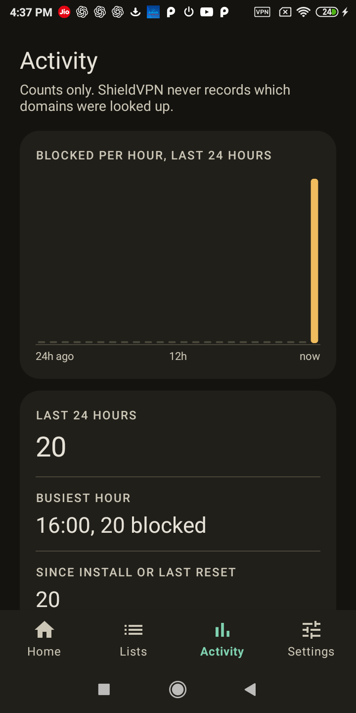

# ShieldVPN

**System-wide ad and tracker blocking for Android. No root, no browser, one toggle.**

ShieldVPN runs a tiny local VPN on your phone and filters DNS lookups from *every* app
using [Brave's `adblock-rust`](https://github.com/brave/adblock-rust) engine and the
same family of filter lists browsers use (EasyList, EasyPrivacy, uBlock filters,
Peter Lowe's list). Blocked domains simply don't resolve. Nothing leaves your phone except
ordinary DNS lookups.

> **Status: beta (v0.1.0-beta).** Tested on one real device (Redmi 6, Android 9).
> See [Known limits](#known-limits) before you rely on it.

<p align="center">
  
  
  
</p>

## Why

Brave blocks ads well, but only inside Brave. This brings the same engine to the whole
phone: other browsers, apps, games, system services.

## How it works

```
 any app ──DNS query──▶ Android ──▶ TUN (10.111.222.2 only) ──▶ ShieldVPN
                                                                    │
                          adblock-rust (Rust, via JNI)  ◀── "is this host blocked?"
                                                                    │
                 blocked ──▶ NXDOMAIN, answered on the device       │
                 allowed ──▶ forwarded to 1.1.1.1 / 9.9.9.9 / custom (protect()ed socket)
```

- Only the fake DNS address is routed into the VPN. **All other traffic bypasses it**, so
  there is no packet forwarding, almost no CPU use, and no battery drama.
- Filter lists are downloaded over HTTPS, size-capped, validated, and swapped in
  atomically. They are matched on-device.
- Turning it off removes the VPN interface and Android immediately goes back to your
  normal network DNS. The app changes no persistent phone setting.

## Features

- One-tap on/off with a clear state: *Protected*, *Starting*, *Not filtering*, *Off*
- Four lists with per-list switches, sizes and update times
- Counters only: blocked today, total, and per hour. **Domains are never logged or stored.**
- Choice of upstream DNS (Cloudflare, Quad9 or a custom IPv4 address, validated)
- Warns when Android's *Private DNS* would bypass the filter
- Light and dark themes

## Known limits

Read these. They are inherent to DNS-level blocking on a non-rooted phone.

- **YouTube app ads are not blocked.** Brave blocks YouTube ads with injected scripts and
  page rules inside the browser. A VPN cannot do that. YouTube serves ads from the same
  domains as the video, so blocking by domain would break playback instead.
- No cosmetic filtering (hiding page elements) and no `$third-party` rule matching.
- Apps that use their own DNS-over-HTTPS, and Android *Private DNS* set to a hostname,
  bypass the filter.
- Upstream DNS is plain (unencrypted) UDP. Encrypted upstream is on the roadmap.
- IPv4 only. One VPN at a time (Android limitation), so it can't run alongside another VPN.
- **If Android kills the app, it does not restart by itself on some phones** (seen on MIUI).
  Your internet keeps working normally; blocking is just off until you reopen the app. Allow
  *Autostart* and set battery to *No restrictions* for the app.
- Doesn't resume after a reboot. Open the app and tap the ring.
- Do **not** enable Android's "Block connections without VPN": only DNS goes through the VPN.

## Install the beta

1. Download `ShieldVPN-0.1.0-beta.apk` from the [Releases](../../releases) page.
2. Allow installs from your browser or file manager when Android asks.
3. Open the app, go to **Lists → Update all lists**, then tap the ring on **Home** and accept
   Android's VPN prompt.

Verify the download with the SHA-256 in the release notes. The APK is signed with a
dedicated beta key (certificate SHA-256 is also in the release notes).
Requires Android 8.0+. Native libraries are included for arm64, armv7 and x86_64.

## Build from source

Needs JDK 17, the Android SDK (platform 34, build-tools), the NDK (r26+), Rust (stable) and
[`cargo-ndk`](https://github.com/bbqsrc/cargo-ndk).

```bash
rustup target add aarch64-linux-android armv7-linux-androideabi x86_64-linux-android
cargo install cargo-ndk

cd shieldvpn
./scripts/build-core.sh          # builds libshieldcore.so for all ABIs + runs the Rust tests
./gradlew :app:assembleDebug     # app/build/outputs/apk/debug/app-debug.apk
./gradlew :app:testDebugUnitTest # Kotlin unit tests
```

Set `sdk.dir` in `shieldvpn/local.properties`. For a signed release build, point
`SHIELDVPN_KEYSTORE_PROPS` at a `keystore.properties` file (kept outside the repo) with
`storeFile`, `storePassword`, `keyAlias`, `keyPassword`, then run `:app:assembleRelease`.

## Project layout

| Path | What |
|---|---|
| `shieldvpn/core/` | Rust crate: `adblock-rust` behind a small JNI API, with host tests |
| `shieldvpn/app/` | Kotlin app: VPN service, DNS packet parser, list manager, UI |
| `shieldvpn/docs/DESIGN.md` | Architecture and constraints |
| `shieldvpn/docs/STATUS.md` | Build and review log |

## Quality and security

- 18 Kotlin unit tests (DNS parsing, reply validation, EDNS clamping, TCP reset, list
  sanity checks, session handling) and 5 Rust tests (blocking, `@@` exceptions, garbage
  input, bad or double-freed handles, oversized input).
- Reviewed in rounds for security and memory by independent reviewers. Findings were fixed
  (strict DNS reply validation, atomic engine swap, fail-visible "Not filtering" state,
  per-session cleanup, bounded buffers, list-body validation, JNI handle registry).
  The last round of fixes was verified by tests, not by a further independent review.
- Measured on device: about 59 MB total memory with 114,796 rules loaded, ~0% CPU idle.
- Manifest: service not exported, no backups, no cleartext traffic, only `INTERNET` and
  `FOREGROUND_SERVICE` permissions, no analytics, no boot receiver.

## Roadmap

- Encrypted upstream DNS (DoH/DoT)
- Optional resume after reboot, and a notification if protection stops unexpectedly
- Custom user rules and per-app allowlist
- IPv6 DNS

## Credits and licenses

- [`brave/adblock-rust`](https://github.com/brave/adblock-rust) (MPL-2.0) does the matching.
- Filter lists are **downloaded at runtime and not bundled**: EasyList and EasyPrivacy
  (easylist.to), uBlock filters, Peter Lowe's list. Each keeps its own license.
- Not affiliated with Brave Software.

## License

[MIT](LICENSE). Third-party components keep their own licenses: `adblock-rust` (MPL-2.0),
Material Components for Android (Apache-2.0), and the Rust crates listed in
`shieldvpn/core/Cargo.lock` (mostly MIT or Apache-2.0).
