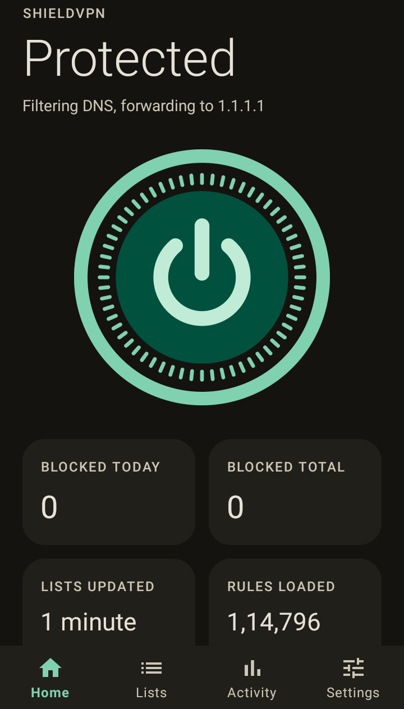
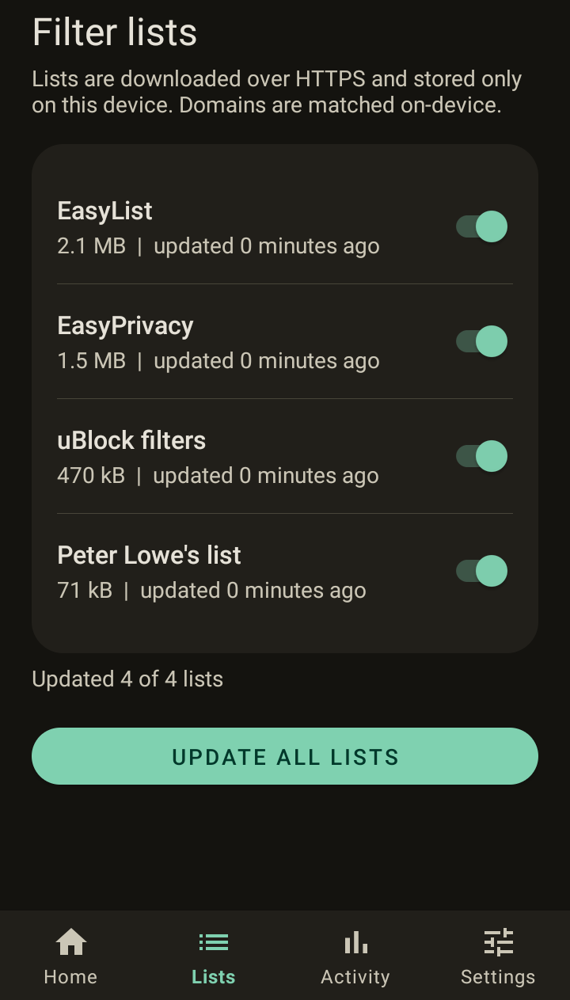
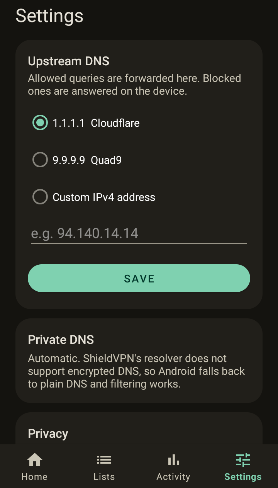

<div align="center">

# ShieldVPN

**System-wide ad and tracker blocking for Android.**<br>
No root. No browser. One toggle.


<br>


&nbsp;

&nbsp;

&nbsp;


</div>

---

Brave blocks ads well, but only inside Brave. ShieldVPN brings the same matching engine,
[`adblock-rust`](https://github.com/brave/adblock-rust), and the same default filter lists to the
whole phone: other browsers, apps, games, system services.

It runs a tiny local VPN that sees **only DNS lookups**. A blocked domain simply never
resolves. Everything else on your connection is untouched.

> **Status: beta.** Tested on one real device (Redmi 6, Android 9). Read
> [Known limits](#known-limits) before relying on it.

## How it works

```
 any app ──DNS query──▶ Android ──▶ TUN (10.111.222.2 only) ──▶ ShieldVPN
                                                                    │
                      adblock-rust (Rust, via JNI)  ◀── "is this host blocked?"
                                                                    │
             blocked ──▶ NXDOMAIN, answered on the device           │
             allowed ──▶ forwarded to 1.1.1.1 / 9.9.9.9 / custom (protect()ed socket)
```

- Only the fake DNS address is routed into the VPN. **All other traffic bypasses it**, so
  there is no packet forwarding, almost no CPU use and no battery drama.
- Filter lists are downloaded over HTTPS, size-capped, validated, merged and swapped in
  atomically. Matching happens on the device.
- Turning it off removes the VPN interface and Android goes straight back to your normal DNS.
  The app changes no persistent phone setting.

## Filter lists

The first three lists are the ones Brave Shields enables by default, taken from Brave's
own [`list_catalog.json`](https://github.com/brave/adblock-resources). The last two are
DNS-focused lists that cover telemetry and ad hosts which Brave handles with page scripts.

| List | What is inside |
|---|---|
| **Brave default adblock** | EasyList, uBlock filters (general + 2020 to 2026), badware, resource-abuse, unbreak, quick-fixes, link shorteners, URLhaus malware, and Brave's own `specific`, `social`, `unbreak`, `android-specific`, `sugarcoat` lists |
| **Brave default privacy** | EasyPrivacy, uBlock privacy |
| **Brave first-party filters** | Brave's first-party and regional first-party rules |
| **HaGeZi Pro (DNS)** | Ads, trackers and OEM/app telemetry (Xiaomi, Realme, Oppo, Huawei, Apple and more) |
| **Peter Lowe's list** | Classic ad server hostnames |

Lists are **downloaded at runtime, never bundled**. Each can be switched off in the app.

DNS lookups carry no page context, so the engine is asked as if the request came from a
different site (third-party) and as any common subresource type. That lets Brave's
`$third-party` and typed rules apply, which is most of its tracker coverage.

## Test results

Checked against the 126 hostnames probed by
[adblock.turtlecute.org](https://adblock.turtlecute.org/), matching the lists offline at
domain level (an approximation of the engine, not a run on a phone):

| List set | Blocked |
|---|---|
| Brave's default lists alone | 78 / 126 (62%) |
| Previous ShieldVPN lists | 83 / 126 (66%) |
| **Brave lists + HaGeZi Pro (current)** | **124 / 126 (98%)** |

Still missed in this approximation: `ads.pinterest.com`, `ads.tiktok.com`. Brave's lists alone
score lower than 100% here because Brave blocks part of this test with scriptlets and cosmetic
rules inside the page, which no DNS filter can run. **Re-run the test on your phone with the
VPN on and compare**; real results depend on your device, DNS and apps.

## Features

- One-tap on/off with a clear state: *Protected*, *Starting*, *Not filtering*, *Off*
- Five lists with per-list switches, sizes and update times
- Counters only: blocked today, total, and per hour. **Domains are never logged or stored.**
- Choice of upstream DNS (Cloudflare, Quad9 or a custom IPv4 address, validated)
- Warns when Android's *Private DNS* would bypass the filter
- Light and dark themes

## Known limits

Inherent to DNS-level blocking on a non-rooted phone.

- **YouTube app ads are not blocked.** Brave blocks YouTube ads in the browser with scripts
  that rewrite the player response in the page. A VPN cannot do that, and YouTube serves
  ads from the same domains as the video, so blocking the domain would break playback.
- No cosmetic filtering (hiding page elements) and no scriptlets.
- Apps with their own DNS-over-HTTPS, and Android *Private DNS* set to a hostname, bypass
  the filter.
- Upstream DNS is plain (unencrypted) UDP. Encrypted upstream is on the roadmap.
- IPv4 only. One VPN at a time (Android limitation).
- **If Android kills the app it may not restart by itself** (seen on MIUI). Your internet keeps
  working; blocking is just off until you reopen the app. Allow *Autostart* and set battery to
  *No restrictions*.
- Does not resume after a reboot. Open the app and tap the ring.
- Do **not** enable Android's "Block connections without VPN": only DNS goes through the VPN.
- Bigger lists use more memory. Measured at about 59 MB with the original 115k rules; the
  larger Brave and HaGeZi set has not been measured on a device yet.

## Install the beta

1. Download the APK from the [Releases](../../releases) page.
2. Allow installs from your browser or file manager when Android asks.
3. Open the app, go to **Lists → Update all lists**, then tap the ring on **Home** and accept
   Android's VPN prompt.

Verify the download with the SHA-256 in the release notes. Requires Android 8.0+. Native
libraries are included for arm64, armv7 and x86_64.

## Build from source

Needs JDK 17, the Android SDK (platform 34, build-tools), the NDK (r26+), Rust (stable) and
[`cargo-ndk`](https://github.com/bbqsrc/cargo-ndk).

```bash
rustup target add aarch64-linux-android armv7-linux-androideabi x86_64-linux-android
cargo install cargo-ndk

cd shieldvpn
./scripts/build-core.sh          # builds libshieldcore.so for all ABIs and runs the Rust tests
./gradlew :app:assembleDebug     # app/build/outputs/apk/debug/app-debug.apk
./gradlew :app:testDebugUnitTest # Kotlin unit tests
```

Set `sdk.dir` in `shieldvpn/local.properties`. For a signed release build, point
`SHIELDVPN_KEYSTORE_PROPS` at a `keystore.properties` file (kept outside the repo) with
`storeFile`, `storePassword`, `keyAlias`, `keyPassword`, then run `:app:assembleRelease`.

## Project layout

| Path | What |
|---|---|
| `shieldvpn/core/` | Rust crate: `adblock-rust` behind a small JNI API, with host tests |
| `shieldvpn/app/` | Kotlin app: VPN service, DNS packet parser, list manager, UI |
| `shieldvpn/docs/DESIGN.md` | Architecture and constraints |
| `shieldvpn/docs/STATUS.md` | Build and review log |

## Quality and security

- Kotlin unit tests (DNS parsing, reply validation, EDNS clamping, TCP reset, list sanity
  checks, session handling) and Rust tests (blocking, `@@` exceptions, third-party and typed
  rules, garbage input, bad or double-freed handles, oversized input).
- Reviewed in rounds for security and memory. Findings were fixed: strict DNS reply
  validation, atomic engine swap, fail-visible "Not filtering" state, per-session cleanup,
  bounded buffers, list-body validation, JNI handle registry.
- Manifest: service not exported, no backups, no cleartext traffic, only `INTERNET` and
  `FOREGROUND_SERVICE` permissions, no analytics, no boot receiver.

## Roadmap

- Encrypted upstream DNS (DoH/DoT)
- Optional resume after reboot, and a notification if protection stops unexpectedly
- Custom user rules and per-app allowlist
- IPv6 DNS

## Credits and licenses

- [`brave/adblock-rust`](https://github.com/brave/adblock-rust) (MPL-2.0) does the matching.
- Filter lists keep their own licenses: EasyList and EasyPrivacy (easylist.to), uBlock
  Origin's uAssets, Brave's adblock-lists, URLhaus filter, HaGeZi DNS blocklists, Peter Lowe's list.
- Not affiliated with Brave Software.

## License

[MIT](LICENSE). Third-party components keep their own licenses: `adblock-rust` (MPL-2.0),
Material Components for Android (Apache-2.0), and the Rust crates listed in
`shieldvpn/core/Cargo.lock` (mostly MIT or Apache-2.0).
